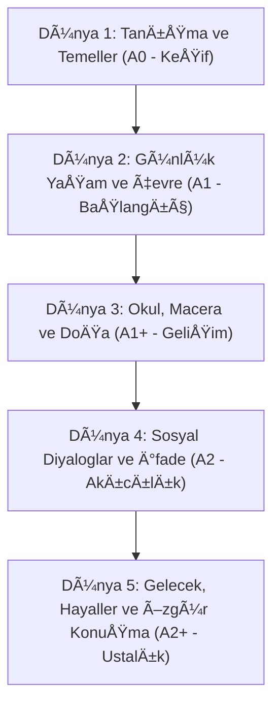

# PipiTalk: Kapsamlı Müfredat ve İlerleme Mimarisi

Bu belge; Duolingo ve Kids Lingo modellerini aşacak şekilde hazırlanan **PipiTalk** mobil uygulamasının tam pedagojik ve teknik müfredat mimarisidir.

---

## 1. Genel Seviye Piramidi (CEFR Uyumlu)

Uygulama 5 ana dünyadan (Dünya / Bölge) ve her dünyada 10 üniteden oluşur. Toplam 50 ünite, 250 ders ve 1.500+ mikro-etkinlik içerir.

---

## 2. Dünyalar ve Ünite Detayları

### Dünya 1: Keşif Vadisi (A0)
* **Ünite 1:** Merhaba Dünya (Greetings, Self Introduction)
* **Ünite 2:** Renkli Bahçe (Colors & Basic Shapes)
* **Ünite 3:** Sayıların Dansı (Numbers 1-20 & Counting)
* **Ãœnite 4:** Sevimli Dostlar (Animals & Sounds)
* **Ãœnite 5:** Ailem ve Evim (Family Members & Home)
* **Ãœnite 6:** Meyve Sepeti (Fruits & Tastes)
* **Ünite 7:** Kıyafet Dolabı (Clothes & Weather)
* **Ãœnite 8:** Bedenim ve Hareket (Body Parts & Action Verbs)
* **Ãœnite 9:** Oyuncak Kutusu (Toys & Prepositions: in, on, under)
* **Ãœnite 10:** Ara DeÄŸerlendirme & Ä°lk Rozet (Boss Challenge: Pipi's Tea Party)

### Dünya 2: Günlük Kasaba (A1)
* **Ünite 11:** Kahvaltı Zamanı (Food & Drinks, 'I like / I don't like')
* **Ünite 12:** Saat Kaç? (Telling Time, Daily Routine)
* **Ünite 13:** Şehirde Gezinti (Places in Town, Directions)
* **Ünite 14:** Duygularımız (Feelings: Happy, Sad, Excited, Tired)
* **Ãœnite 15:** Meslekler (Jobs & Occupations)
* **Ünite 16:** Günler, Aylar ve Mevsimler (Calendar & Weather Routine)
* **Ünite 17:** Süpermarkette (Shopping, How much / How many)
* **Ünite 18:** Ulaşım Araçları (Vehicles & Travel)
* **Ünite 19:** Ev İçi Görevler (House Chores, 'Can / Can't')
* **Ãœnite 20:** Kasaba Festivali (Boss Challenge: Market Master)

### Dünya 3: Doğa ve Macera (A1+)
* **Ãœnite 21:** Orman Gezisi (Wild Animals & Habitats)
* **Ünite 22:** Deniz Altı Dünyası (Sea Creatures & Adjectives: big, fast)
* **Ünite 23:** Sağlıklı Yaşam (Sports, Healthy Habits)
* **Ãœnite 24:** Hobiler ve Yetenekler (Musical Instruments, Crafting)
* **Ünite 25:** Doğum Günü Partisi (Invitations, Months, Giving Gifts)
* **Ãœnite 26:** Kamp AteÅŸi (Camping, Simple Past: What happened?)
* **Ãœnite 27:** Uzay ve Gezegenler (Planets, Stars, Comparisons)
* **Ünite 28:** Çiftlik Günlüğü (Farm Life, Present Continuous)
* **Ünite 29:** Bilim Kulübü (Simple Experiments & Questions: Why? How?)
* **Ãœnite 30:** DoÄŸa KaÅŸifi (Boss Challenge: Jungle Survival)

### Dünya 4: İletişim Adası (A2)
* **Ãœnite 31:** Restoranda SipariÅŸ (Ordering Food, Politeness)
* **Ãœnite 32:** Doktor Randevusu (Health Problems, Giving Advice: Should)
* **Ünite 33:** Kayıp Eşya Bürosu (Describing Objects & People)
* **Ünite 34:** Tatil Planları (Future Plans: Going to, Travel destinations)
* **Ãœnite 35:** Sinema ve Masallar (Storytelling, Sequencing words)
* **Ünite 36:** Çevre Dostu Pipi (Recycling, Planet Protection)
* **Ünite 37:** Telefon Görüşmesi (Making Calls, Leaving Messages)
* **Ünite 38:** Alışveriş Merkezi (Fashion, Sizes, Preferences)
* **Ünite 39:** İlginç Meslekler (Inventors, Astronauts, Past Tense)
* **Ünite 40:** Ada Röportajı (Boss Challenge: Interview Pipi)

### Dünya 5: Bilge Zirve (A2+)
* **Ünite 41:** Dünya Kültürleri (Countries, Nationalities, Traditions)
* **Ünite 42:** Geleceğin Şehirleri (Technology, AI, Inventions)
* **Ünite 43:** Problem Çözme (Giving Opinions: I think, Because...)
* **Ãœnite 44:** Gizemli Macera (Detective Stories, Deduction)
* **Ünite 45:** Sanat ve Yaratıcılık (Paintings, Photography, Music Genres)
* **Ãœnite 46:** Dostluk ve Empati (Sharing emotions, Resolving conflicts)
* **Ünite 47:** Bilim Kurgu Dünyası (Future Tense: Will, Imagining)
* **Ünite 48:** Münazara Saati (Debating, Pros and Cons)
* **Ünite 49:** Hayatımın Kitabı (Reflecting on Achievements)
* **Ünite 50:** Büyük Mezuniyet (Final Challenge: Free Talk with Pipi)

---

## 3. Günlük Ders Akışı ve Mikro-Alıştırma Tipleri

Her ünite 5 dersten, her ders ise 6-8 interaktif adımdan oluşur:

| Sıra | Aşama | Amaç | Etkinlik Tipi |
| :--- | :--- | :--- | :--- |
| 1 | **Keşif (Discover)** | Kelime ve kalıbı ilk kez duyma | Resim eşleme, sesli dinleme, maskot tepkisi |
| 2 | **Pekiştirme (Reinforce)** | Hafızaya alma | Çift kart eşleştirme, eksik harf tamamlama |
| 3 | **Cümle Kurma (Build)** | Gramer mantığını sezgisel öğrenme | Kelime bloklarını sıraya dizme |
| 4 | **Dinleme & Anlama (Listen)** | Kulak dolgunluğu | Ses kaydını dinleyip doğru görseli/cevabı seçme |
| 5 | **Konuşma & Telaffuz (Speak)** | Ağız alışkanlığı | Mikrofona söyleme (Pipi ses tanıma geri bildirimi) |
| 6 | **Pipi ile Canlı Diyalog (AI Chat)** | Serbest pratik | Pipi ile 2 turlu mini sesli konuşma |

---

## 4. PipiTalk Özel Dinamikleri (Duolingo'yu Aşan Noktalar)

1. **Serbest AI KonuÅŸma Modu (Pipi Live):**
   * Sadece kalıpları ezberletmez; çocuk "Bugün ne yaptın?" sorusuna kendi cümleleriyle cevap verebilir.
2. **Çocuk Dostu Hata Toleransı:**
   * Duolingo gibi katı can cezalandırması yerine, şefkatli geri bildirim ve ipucu sistemi.
3. **Özgün Maskot Ruh Hali (Pipi Emotions):**
   * Pipi çocuk konuştukça alkışlar, dans eder, şaşırır veya ipucu verir.
4. **Çevrimdışı Çalışma Garantisi:**
   * Tüm temel dersler internet olmadan da çalışır. Sadece ileri seviye AI konuşma internetle zenginleşir.
